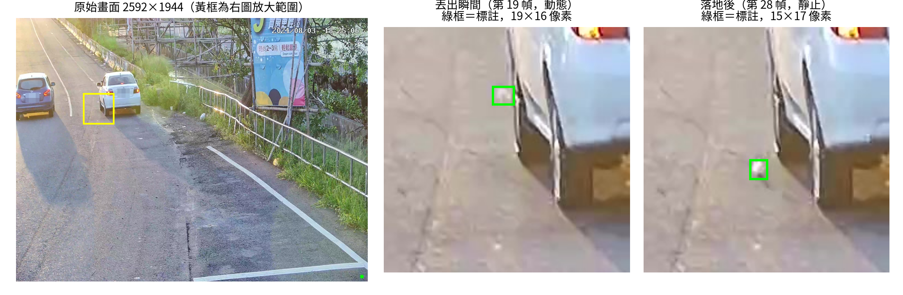
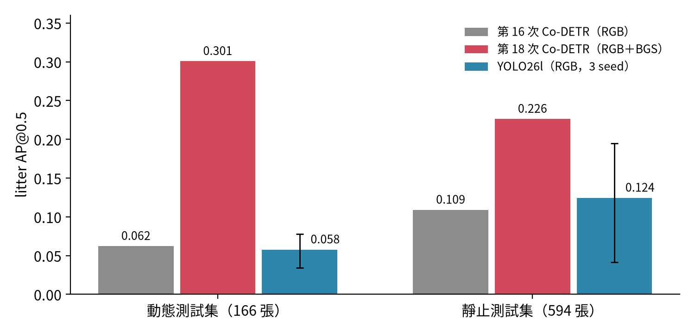
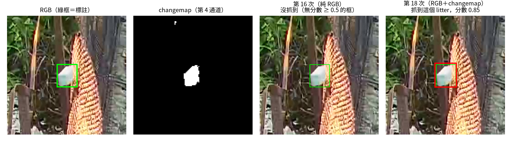
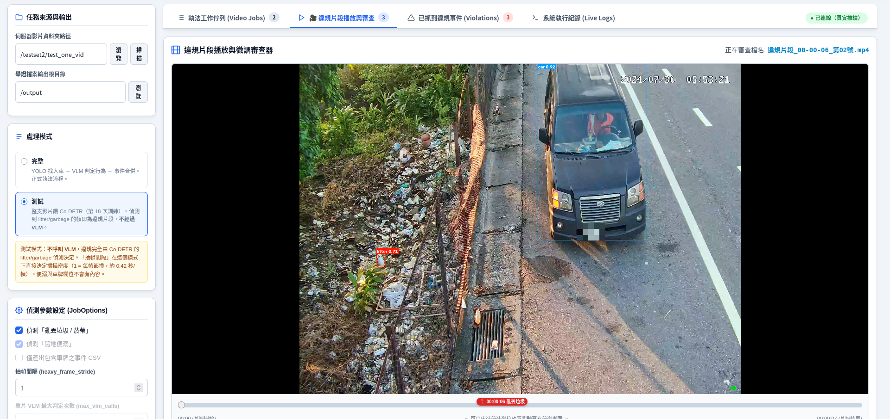
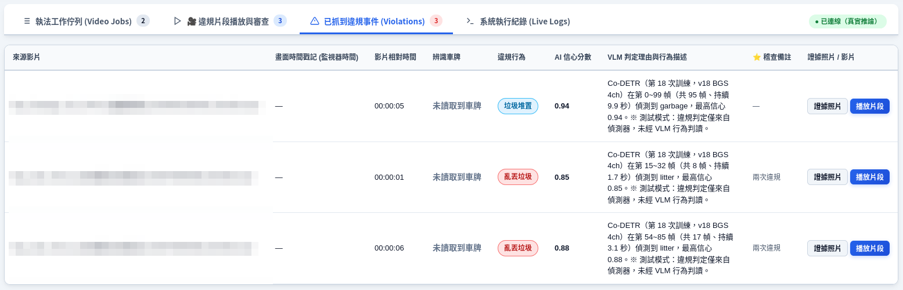

[English](README.md) | **中文**

# 環保科技執法：監視器影片中的違規丟棄垃圾偵測

亂丟垃圾的取締高度依賴監視器，但違規畫面仍要由稽查人員一段一段看過才找得出來。
這個專題訓練一個偵測模型，從固定式路口監視器影片中找出**正在丟垃圾**的畫面，稽查人員只需要確認模型挑出來的片段。

本 repo 包含完整實作：資料集建構、訓練流程、評估方法、YOLO 對照實驗，以及模型接入的執法系統。
**不附模型權重與資料。** 影像由地方環保局提供，內含車牌與行人。


*測試集同一部 clip 的同一個垃圾：丟出瞬間（19×16 像素）與落地後（15×17 像素），原始畫面為 2592×1944。*

## 任務與資料

- **影像來源：** 固定式路口監視器，2592×1944、每秒 10 幀，含違規事件的段落剪成短片（clip）。
- **類別（5 類）：** car、motorcycle、person、**litter**（小型垃圾，如菸蒂、寶特瓶、盒子）、**garbage**（大型垃圾，如垃圾袋、行李箱）。
- **資料集：** 122 部 clip、9,349 幀，全部逐幀人工標註，共 51,816 個框，其中 litter 5,467 個、garbage 1,263 個。
- **切分：** 以 clip 為單位（訓練 99／驗證 15／測試 8），同一部 clip 不會同時出現在兩個集合。
- **困難所在：** 影像長邊縮到 1024 像素後，litter 框的寬、高中位數只有約 **11×13 像素**。

## 方法：四個實際走過的循環

我的做法是：先把問題定義清楚，想出解法並實作，再用合適的指標檢驗；沒有解決，就先查清楚是哪個環節、什麼原因，再修改解法。
整個專題累積了 18 次訓練與一組 YOLO 對照實驗，其中四個轉折點如下。

**1. 先讓模型在訓練集上學得起來。**
第 6 次訓練時，litter 連訓練集都只抓到 7%。第 7 次同時加上三種補償：含垃圾的圖片過採樣、litter 與 garbage 的分類 loss 乘 5 倍，以及主幹與偵測頭使用不同學習率。訓練集漏抓率從 93% 降到 15%。
之後每次換資料，我都先確認訓練集上的表現。

**2. 重新定義問題：我們到底要抓哪一種「垃圾」。**
另一位同學標註的 litter 有 71–80% 每幀移動超過 20 像素；我們的測試集卻有 **84% 幾乎不動**（位移中位數 2.4 像素）。
執法需要的是「丟出來」這個動作，地上已有的垃圾不等於違規。所以我把評估拆成兩把尺：

| 測試集 | 內容 | 衡量什麼 |
|---|---|---|
| `dynamic166` | 166 幀，垃圾落地前 | 能不能抓到正在飛行的垃圾 |
| `static594` | 594 幀 | 畫面中有沒有垃圾 |

測試集中有一部 clip 和訓練集的某部 clip 拍到同一個場景、前後只隔 7 分鐘，兩把尺都排除這部 clip。
只用動態幀訓練起初有幫助（第 13 次）；但把動態資料加得更多、更純（第 15～17 次），靜止測試集反而崩落。與其再換第四種取法重訓，我決定停下來先診斷原因。

**3. 把「哪裡在動」交給模型：背景相減 changemap 作為第 4 通道。**
- **第一次嘗試（第 11 次）：** 比純 RGB 差。官方設定凍結了第一層卷積，而新通道的權重正好在這一層。
- **解凍之後（第 12 次）：** 小物件 AP 從 0.000 升到 0.388。
- **靜止垃圾為什麼吃虧（第 14 次）：** 在我們的資料上，69% 的靜止 litter 框在 changemap 上完全是黑的。讀了 OpenCV 原始碼才找到原因：KNN 背景相減的 `learningRate=0` 意思是「每次都更新」而不是「凍結」，靜止物體經過 5 到 6 次更新就會被吸收進背景。
- **單一變因對照（第 18 次）：** 與第 16 次完全相同，只多了 changemap 和必須解凍的第一層。

**4. Co-DETR 是對的選擇嗎？和 YOLO26 公平比較。**
YOLO26l 在同一份切分、同樣五個類別下訓練，跑了 3 個隨機種子，兩個模型都用同一支評分程式計分。
驗證集上 YOLO 明顯落後（litter AP@0.5：0.141 對 0.299）。
一個合理的假設是 YOLO 的格點分配：約 11% 的 litter 框內一個格點都沒有。但縮放實驗（512～1536 像素）**否定**了它是主因：不論哪種尺寸，YOLO 的最大召回率都穩定在 Co-DETR 的 0.47～0.51 倍。

## 成果

測試集 AP@0.5，全部用同一支評分程式計分：

| 模型 | 動態 litter | 動態 garbage | 靜止 litter | 靜止 garbage | 每張圖推論時間 |
|---|---|---|---|---|---|
| 第 16 次 Co-DETR（RGB） | 0.062 | 0.358 | 0.109 | 0.092 | 121.9 ms |
| **第 18 次 Co-DETR（RGB＋changemap）** | **0.301** | **0.371** | **0.226** | 0.062 | — |
| YOLO26l（RGB，3 種子平均，最小～最大） | 0.058（0.035–0.078） | 0.183（0.099–0.293） | 0.124（0.042–0.195） | 0.031（0.021–0.048） | 33.8 ms |

推論時間是在 RTX 4090 上以 FP32 實測。第 18 次另外還要計算 changemap，未列入。



**這個進步有多可靠？** 測試集的 litter 只來自 3 部 clip。
- **以幀為單位做 bootstrap：** 第 18 次減第 16 次的差距，95% 信賴區間是 [0.16, 0.33]。
- **以 clip 為單位做 bootstrap：** 95% 信賴區間是 [−0.08, 0.88]，跨過 0。

第 18 次在這份測試集上明顯較好，但 clip 數不足以宣稱它對新場景也一樣有效。
在純靜止畫面上，進步來自誤報減少，這與 changemap 會吸收靜止物體的機制一致。



## 系統整合

第 18 次模型包成獨立的推論服務，接進執法系統。系統輸入監視器影片，挑出疑似丟棄垃圾的片段，稽查人員在網頁介面上檢視、加註記。




**線上產生 changemap。** 系統只會把稀疏的影格送給模型，但 changemap 必須按順序餵入影格才建得出背景。所以推論服務自己開啟影片、從頭建立背景，再依幀號取出要偵測的畫面。
在 8 部測試 clip 上，這種線上做法和離線流程的結果完全相同（抓對的框都是 44 個）。

**抽幀間隔。** 原本每 35 幀取一幀明顯太大：垃圾在空中的時間中位數只有 3 幀。
調低信心門檻比縮小抽幀間隔更有效率：

| 設定 | 事件命中率 | 誤報 | 運算時間 |
|---|---|---|---|
| 門檻 0.40、每 2 幀跑一次 | 66.7% | 少 38% | 少 43% |
| 門檻 0.50、逐幀跑 | 66.7% | 基準 | 基準 |

## 目錄結構

```
co-detr/                        Co-DETR 訓練流程（MMDetection 3、Docker）
  configs/                      每次訓練各一個 config
    co_dino_chiayi_v17_own_dynamic_head10_manual_36e.py   第 16 次（RGB）
    co_dino_chiayi_v18_own_dynamic_bgs_4ch_36e.py         第 18 次（RGB＋changemap）
  hooks/                        MMDetection 擴充
    load_changemap.py           讀 changemap PNG 作為第 4 通道
    data_preprocessor_4ch.py    4 通道正規化與組 batch
    conv1_ch4_norm_logger.py    追蹤第 4 通道權重是否真的在學
    weighted_focal_loss.py      各類別 loss 權重（第 7 次）
  experiments/NNth_vMM_*/       每次訓練的腳本：資料前處理、dryrun、訓練、推論、事後分析
    16th_v17_own_dynamic_122vids/資料前處理/   界定動態區間（analyze_dynamic_intervals.py、build_v17_*）
    18th_v18_own_dynamic_bgs_122vids/
      資料前處理/gen_changemaps_v18.py          以事件前影格建背景的 KNN changemap
      資料前處理/build_alignment_v18.py         資料集影格與原始影片的幀號對齊
      run_dual_track_eval.sh、metrics_from_preds.py   dynamic166／static594 雙軌評估
  tools/                        共用分析腳本（錯誤分析、影片分類、繪圖）
yolo-baseline/                  YOLO26l 對照組：格式轉換、訓練、端到端評估、
                                bootstrap 信賴區間（bootstrap_ci.py）、縮放實驗（scale_sweep_*.py）、
                                格點分配分析（positive_slots.py）、速度測試
enforcement-system/
  codetr_service/server.py      第 18 次推論服務（線上 changemap）
  codetr_service/verify_lr0*.py KNN learningRate=0 的驗證
  codetr_service/measure_*.py   抽幀間隔與門檻實驗
  webui/                        網頁介面（只用標準函式庫 http.server，不需額外套件）
  enforcement_app/              執法流程：候選幀 → 偵測 → 事件合併 → 舉證
```

實驗資料夾以訓練次數編號（`NNth`），資料集版本另外編號（`vMM`）。
較早的訓練（第 5～15、17 次）保留作為迭代過程的紀錄，不再維護。
程式碼註解是繁體中文。早期腳本的部分註解反映的是當時的假設，後來已經修正，例如把 `learningRate=0` 稱為「凍結」背景（見循環三）。

## 執行方式

訓練與評估都在 Docker 內執行。腳本中的路徑寫成 `/path/to/data`（資料集與訓練結果）和 `/path/to/repo`，請換成自己的路徑。

```bash
# Co-DETR image（PyTorch 2.1、MMCV 2.1、MMDetection 3.x 含 projects/CO-DETR）
docker build -t co-detr:latest co-detr/

# 第 18 次訓練（2 張 GPU，DDP）
bash co-detr/experiments/18th_v18_own_dynamic_bgs_122vids/train_18th_v18_bgs_4ch_ddp.sh

# 第 16、18 次雙軌評估
bash co-detr/experiments/18th_v18_own_dynamic_bgs_122vids/run_dual_track_eval.sh

# 執法系統：Co-DETR 服務＋Ollama＋主程式容器
cd enforcement-system && cp .env.example .env   # 填入路徑
docker compose up -d
bash webui/webui.sh start   # 網頁介面，127.0.0.1:8080
bash webui/webui.sh mock    # 或：用假資料開介面，不需模型
```

**資料格式。** 每個集合一份 COCO 格式 JSON。4 通道模型的每張影像，要在 `{split}_changemap/` 下有一張同檔名的二值 changemap PNG：

```
<dataset>/
  annotations/{train,valid,test}.json, test_dynamic166.json, test_static594.json
  {train,valid,test}/<clip>_frame_NNNN.jpg
  {train,valid,test}_changemap/<clip>_frame_NNNN.png    # 0 / 255
```

## 下一步

- **加入多物件追蹤（MOTIP）過濾誤報。** 只保留符合丟棄過程的軌跡：從人或車旁出現、移動、再落地。
- **加速。** 每張圖 121.9 毫秒，再加上 changemap 的計算，目前還無法即時處理每秒 10 幀的串流。
- **加入視覺語言模型判斷行為。** 辨識丟出的動作本身，以及隨地便溺這類不涉及物件的違規。

## 致謝

影像標註由我與專題夥伴共同完成；專題夥伴另外負責車牌辨識（不在本 repo 範圍內）。
本專題建立在 [MMDetection](https://github.com/open-mmlab/mmdetection)／[Co-DETR](https://github.com/Sense-X/Co-DETR)（Apache-2.0）與 [Ultralytics](https://github.com/ultralytics/ultralytics)（AGPL-3.0，僅以套件形式用於對照組）之上。

## 授權

[MIT](LICENSE)
